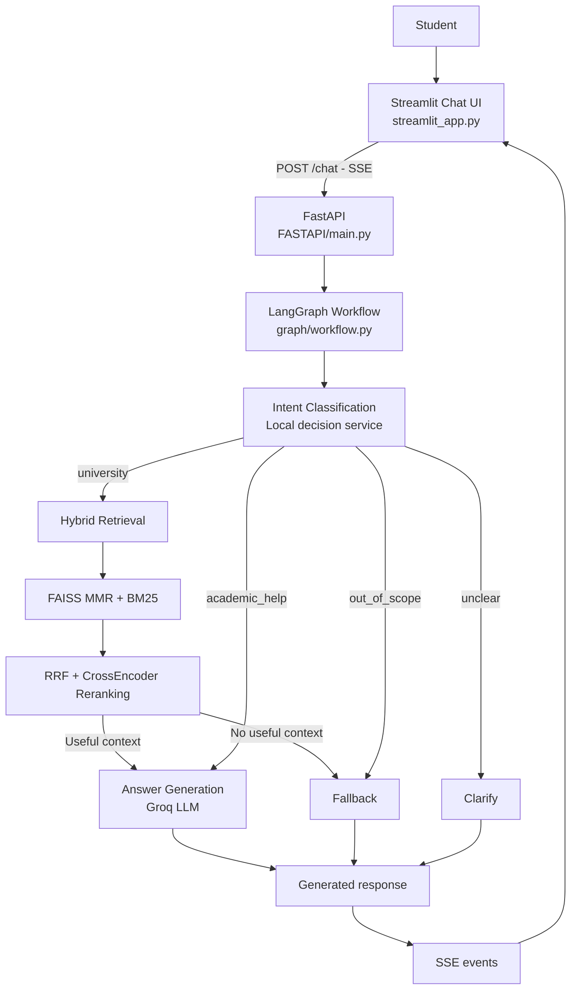

# Uni-Bot — AI-Powered University Knowledge Assistant

     

Uni-Bot is a locally run university information and academic learning assistant. It combines retrieval-augmented generation (RAG), intent-based routing, hybrid document retrieval, and a chat interface to help students find university information and understand academic or technical topics.

The main application path uses a **Streamlit frontend**, a **FastAPI streaming API**, and a **LangGraph workflow**. University-specific answers are generated using retrieved university documents. Academic-help questions are routed to the answer generator without university-document retrieval.

> **Project scope:** The current implementation is a locally run, workflow-orchestrated RAG assistant. It is not a fully autonomous multi-agent system and does not currently include cloud deployment or persistent database-backed conversation storage.

---

## Quick Navigation

**[Features](#features)** · **[Architecture](#application-architecture)** · **[Tech Stack](#technology-stack)** · **[Repository Structure](#repository-structure)** · **[Prerequisites](#prerequisites)** · **[Installation](#installation-and-configuration)** · **[Run Locally](#running-the-main-application-locally)** · **[Chat API](#chat-api)** · **[Evaluation](#evaluation-and-testing)** · **[Limitations](#conversation-memory-and-current-limitations)**

---

## Features

- **University information assistance:** Answers questions about university information using indexed PDF and DOCX documents.
- **Academic and technical assistance:** Handles academic concepts and technical questions such as programming, algorithms, and computer science.
- **Four-way intent routing:** Classifies queries as `university`, `academic_help`, `out_of_scope`, or `unclear`.
- **Hybrid retrieval:** Combines FAISS-based MMR retrieval and BM25 keyword search.
- **Rank fusion and reranking:** Uses Reciprocal Rank Fusion (RRF), followed by a Sentence Transformers CrossEncoder reranker.
- **Conversation-aware queries:** Uses recent conversation messages to help resolve follow-up questions.
- **Streaming responses:** Sends generated response chunks from FastAPI to Streamlit using Server-Sent Events (SSE).
- **Document ingestion:** Extracts PDF/DOCX content, including PDF text, table rows, and OCR text.
- **Local evaluation assets:** Includes routing, workflow, retrieval, generator, and security evaluation code and datasets.
- **Optional standalone RAG interface:** `app.py` provides a separate Streamlit interface that directly loads the vector store and RAG chain.

## Application Architecture



<details>
<summary>Explore the LangGraph workflow, intent routing, model services, and retrieval pipeline</summary>

### LangGraph workflow

The graph is defined in `graph/workflow.py` and contains five nodes:

| Node | Responsibility |
|---|---|
| `classify_intent` | Classifies the incoming request into one of the four supported intents. |
| `retrieve_docs` | Retrieves university-document chunks for university-specific questions. |
| `generate_answer` | Generates the answer and streams text chunks through the LangGraph custom stream writer. |
| `fallback` | Handles out-of-scope questions and university questions for which useful document context was not retrieved. |
| `clarify` | Asks the student to add detail when the request is unclear. |

Routing behavior:

- `university` → retrieve documents → generate an answer if useful context is found; otherwise use the fallback response.
- `academic_help` → generate an academic/technical answer directly, without the university-document retrieval branch.
- `out_of_scope` → return the scope fallback response.
- `unclear` → ask the student to clarify the question.

There is no separate greeting node in the current graph.

### Intent classification and answer generation

The workflow uses two separate model services for its main language-processing stages:

- **Intent classification:** The classifier sends a decision request to the configured Ollaya-compatible service at `/api/decide`. The current defaults are `OLLAYA_BASE_URL=http://127.0.0.1:11435` and `OLLAYA_MODEL=decider:2b`.
- **Answer generation:** The LangGraph answer chain uses LangChain's `ChatGroq`, configured in `src/llm.py` with the Groq model `openai/gpt-oss-120b`.

The generator prompt has different handling rules for university questions and academic-help questions. University-specific claims are expected to be supported by retrieved university context. Academic-help questions are answered as academic or technical explanations.

### Retrieval pipeline

The university retrieval path is implemented by `src/retriever.py`:

1. **Embeddings:** `sentence-transformers/all-MiniLM-L6-v2` creates vector representations.
2. **Dense retrieval:** FAISS is queried using Maximal Marginal Relevance (MMR), configured to fetch up to 60 candidates and return up to 30 candidates for fusion.
3. **Keyword retrieval:** BM25 retrieves up to 30 candidates using tokenized query terms.
4. **Reciprocal Rank Fusion:** RRF combines the two candidate lists.
5. **Reranking:** `cross-encoder/ms-marco-MiniLM-L-6-v2` scores the fused query-document pairs.
6. **Final results:** The configured `TOP_K` is 5.

Current chunk configuration in `src/config.py`:

| Setting | Value |
|---|---:|
| Embedding model | `sentence-transformers/all-MiniLM-L6-v2` |
| Chunk size | 1,024 characters |
| Chunk overlap | 200 characters |
| Final retrieval count (`TOP_K`) | 5 |

### Document ingestion and vector store

The ingestion pipeline is implemented in `src/loader.py`, `src/ingest.py`, and `src/vector_store.py`.

- **PDF text:** PyPDFLoader extracts page text.
- **PDF OCR:** `pdfplumber` renders pages and `pytesseract` extracts OCR text. The loader adds OCR lines that are missing from the native extracted text.
- **PDF tables:** `pdfplumber` extracts tables and converts eligible rows into structured documents with source, page, table, and row metadata.
- **DOCX:** Docx2txtLoader extracts Word document text.
- **Normalization and chunking:** Text is normalized, then non-table documents are split using `RecursiveCharacterTextSplitter`. Extracted table rows are retained as row-level documents.
- **FAISS persistence:** The vector store saves `index.faiss`, `index.pkl`, and `chunks.pkl` under `vectorstore/`.

The vector-store builder creates and validates a staging index before replacing the previous index. This helps avoid replacing a working local index with an incomplete build.

</details>

## Technology Stack

| Area | Technology |
|---|---|
| Frontend | Streamlit |
| Backend API | FastAPI, Uvicorn |
| Workflow orchestration | LangGraph |
| LLM framework | LangChain |
| Intent classification | Ollaya-compatible local decision service |
| Main answer generation | Groq (`openai/gpt-oss-120b`) |
| Embeddings | Sentence Transformers / Hugging Face |
| Vector store | FAISS (`faiss-cpu`) |
| Keyword retrieval | BM25 (`rank-bm25`) |
| Reranking | Sentence Transformers CrossEncoder |
| PDF processing | PyPDF, pdfplumber |
| OCR | Tesseract OCR, pytesseract |
| DOCX processing | Docx2txt |
| Evaluation | pytest, DeepEval utilities, local Qwen judge |

<details>
<summary>View the complete repository structure and generated-file guidance</summary>

## Repository Structure

```text
uni-chatbot/
├── FASTAPI/
│   └── main.py                 # FastAPI endpoints and SSE streaming
├── graph/
│   ├── nodes.py                # Classifier, retrieval, generation, fallback, clarify
│   ├── routing.py              # Conditional LangGraph routing
│   ├── state.py                # Graph state schema
│   └── workflow.py             # Graph construction and in-memory checkpointing
├── src/
│   ├── config.py               # Project paths and retrieval configuration
│   ├── embeddings.py           # Embedding model setup
│   ├── ingest.py               # Recommended document ingestion command
│   ├── llm.py                  # Groq and local LLM configuration
│   ├── loader.py               # PDF/DOCX loading, OCR, table extraction, chunking
│   ├── prompt.py               # Prompt used by the standalone RAG chain
│   ├── rag_chain.py            # Standalone RAG chain
│   ├── retriever.py            # Hybrid retrieval and reranking
│   └── vector_store.py         # FAISS creation, validation, loading
├── data/
│   └── documents/              # Local source PDFs and DOCX files
├── vectorstore/                # Generated FAISS index and saved chunks
├── tests/                      # Application and integration tests
├── evaluation/                 # Golden datasets and evaluation utilities
├── graph_eval/                 # Routing and workflow evaluation assets
├── security_test/                   # Prompt-injection and safety tests
├── models/                     # Local GGUF model files (not for Git)
├── app.py                      # Optional standalone RAG Streamlit interface
├── streamlit_app.py            # Streamlit frontend for the FastAPI workflow
├── rebuild_vectorstore.py      # Additional vector-store rebuild utility
├── requirements.txt
└── README.md
```

Generated files, model weights, private documents, and environment secrets should remain local and should not be committed unless there is a specific reason and permission to publish them.

</details>

## Prerequisites

- Windows and Python 3.12 (the project has been developed in a Python 3.12 environment).
- A Groq API key for the main LangGraph answer-generation path.
- The Ollaya-compatible intent decision service running and reachable at the configured `OLLAYA_BASE_URL`.
- Tesseract OCR installed for PDF OCR extraction.
- A working internet connection for downloading Hugging Face embedding and reranker model weights on first use.

### Tesseract OCR configuration

The current `src/loader.py` points to:

```text
C:\Program Files\Tesseract-OCR\tesseract.exe
```

Install Tesseract OCR on Windows. If it is installed at a different path, update `pytesseract.pytesseract.tesseract_cmd` in `src/loader.py` to the correct executable path.

## Installation and Configuration

### 1. Clone the repository

```powershell
git clone <your-repository-url>
cd uni-chatbot
```

### 2. Create and activate a virtual environment

```powershell
py -3.12 -m venv .venv
.\.venv\Scripts\Activate.ps1
```

If PowerShell blocks activation in the current terminal:

```powershell
Set-ExecutionPolicy -Scope Process -ExecutionPolicy RemoteSigned
.\.venv\Scripts\Activate.ps1
```

### 3. Install Python dependencies

```powershell
python -m pip install --upgrade pip
python -m pip install -r requirements.txt
```

Some evaluation scripts require DeepEval, and the local Qwen judge requires a working `llama-cpp-python` installation. Install and configure those optional evaluation dependencies when running those scripts:

```powershell
python -m pip install deepeval llama-cpp-python
```

`llama-cpp-python` installation can depend on the local Python, compiler, CUDA, and GPU configuration.

### 4. Configure environment variables

Create a `.env` file in the project root. Do not commit it to Git.

```env
GROQ_API_KEY=your_groq_api_key
OLLAYA_BASE_URL=http://127.0.0.1:11435
OLLAYA_MODEL=decider:2b
```

The current classifier defaults to the values shown above if the corresponding variables are not overridden. Confirm that the decision service exposes the `/api/decide` endpoint.

The Streamlit API frontend defaults to `http://127.0.0.1:8000`. To change it, set `UNIBOT_API_URL`. FastAPI's allowed frontend origins can be configured with `UNIBOT_CORS_ORIGINS` as a comma-separated list.

### 5. Add university documents

Place the PDF and DOCX files you want indexed in:

```text
data/documents/
```

Create the directory if it does not exist. Use only documents you are permitted to process. Before publishing the repository, confirm that you have permission to redistribute any university brochure or other source document.

### 6. Build or rebuild the knowledge base

From the project root:

```powershell
python -m src.ingest
```

The command loads supported source files, extracts content, generates chunks, and rebuilds the local FAISS index. It prints the number of source files, extracted sections, and stored chunks. After successful ingestion, restart FastAPI so the running process loads the updated knowledge base.

An additional script is available:

```powershell
python rebuild_vectorstore.py
```

Use `python -m src.ingest` as the recommended ingestion entry point because it includes input checks and status output.

## Running the Main Application Locally

Start the intent-classification service and ensure the Groq API key is configured before launching the application.

### Terminal 1 — Start FastAPI

From the project root, with the virtual environment activated:

```powershell
python -m uvicorn FASTAPI.main:app --host 127.0.0.1 --port 8000 --reload
```

Available endpoints:

| Method | Endpoint | Purpose |
|---|---|---|
| `GET` | `http://127.0.0.1:8000/` | API welcome message |
| `GET` | `http://127.0.0.1:8000/health` | Health check |
| `GET` | `http://127.0.0.1:8000/docs` | Interactive OpenAPI documentation |
| `POST` | `http://127.0.0.1:8000/chat` | Streaming chat endpoint |

### Terminal 2 — Start the Streamlit frontend

```powershell
streamlit run streamlit_app.py
```

Open the local address printed by Streamlit, typically `http://localhost:8501`.

The `streamlit_app.py` frontend checks the FastAPI health endpoint, sends the question and conversation `thread_id` to `/chat`, parses SSE events, and displays streamed answer tokens.

## Chat API

`POST /chat` accepts JSON in this format:

```json
{
  "query": "What is the annual fee for BCA Core?",
  "thread_id": "optional-conversation-id"
}
```

- `query` is required, must contain at least one non-whitespace character, and has a maximum length of 4,000 characters.
- `thread_id` is optional. If omitted, FastAPI generates a UUID for the new conversation.
- Reuse the returned `thread_id` for follow-up questions in the same conversation.

The response uses Server-Sent Events:

| Event | Payload / purpose |
|---|---|
| `start` | Provides the conversation `thread_id`. |
| `token` | Provides a streamed text fragment in `text`. |
| `done` | Signals that the response has completed and includes the `thread_id`. |
| `error` | Reports that the request could not be processed. |

<details>
<summary>Open the optional standalone RAG interface instructions</summary>

## Optional Standalone Streamlit RAG Interface

`app.py` is a separate, direct RAG interface. Unlike `streamlit_app.py`, it does not call the FastAPI `/chat` endpoint or use the LangGraph conversation workflow.

The standalone interface:

- Loads the local FAISS vector store and cached retriever/RAG resources.
- Lets a user upload PDF or DOCX files into `data/documents/`.
- Provides a button to rebuild the local knowledge base.
- Displays the answer and the first retrieved source/page when available.
- Uses `get_llm()` from `src/llm.py`, which is configured for a local GGUF model.

To run this optional interface:

```powershell
streamlit run app.py
```

The local model path and CUDA DLL directory in `src/llm.py` are currently machine-specific. Update `LLM_MODEL` and the CUDA DLL path in that file to match your local installation. This standalone route should be treated separately from the main FastAPI + LangGraph + Groq application.

</details>

<details>
<summary>Open evaluation and testing instructions</summary>

## Evaluation and Testing

Evaluation and testing material is organized across `tests/`, `evaluation/`, `graph_eval/`, and `security/`.

A routing regression test can be run with:

```powershell
python -m pytest tests/test_routing.py -v
```

The repository also contains workflow integration tests, API streaming tests, golden question datasets, retrieval evaluation utilities, generator evaluation utilities, and prompt-injection/safety tests. Some scripts require running external services, a Groq API key, DeepEval, or a local Qwen judge. Run the specific test or evaluation script required for the component being tested; do not assume every standalone script can run without its corresponding service and model configuration.

For the local Qwen judge, check the model path in `evaluation/judge_llm.py` before running evaluation. The judge model is an evaluation component and is separate from the Groq model used for the main LangGraph answer generation.

</details>

## Conversation Memory and Current Limitations

- The LangGraph workflow uses `MemorySaver` for in-memory checkpointing. Conversation history is associated with `thread_id`, but is not durable across FastAPI process restarts.
- The current application uses local file storage for source documents and the FAISS index; it does not include a persistent application database.
- Rebuilding the knowledge base does not automatically refresh an already-running FastAPI process. Restart FastAPI after ingestion.
- University answer quality depends on source-document quality, extraction, retrieval, and the generated response. Important fees, dates, eligibility details, and other official information should be checked against the latest university source.
- The project is configured for local development and testing. A production cloud deployment, authentication system, and persistent multi-user conversation store are outside the current implementation.
- The main application needs the configured decision service and Groq API. The optional standalone `app.py` has separate local GGUF model requirements.

<details>
<summary>Review security and repository hygiene guidance</summary>

## Security and Repository Hygiene

- Keep `.env`, API keys, private source documents, local model weights, and generated vector-store files out of Git unless there is a deliberate and authorized reason to publish them.
- Do not commit `.venv/`, `__pycache__/`, `.pyc` files, or local logs.
- `vectorstore/` contains locally generated data. Rebuild it from permitted source documents using `python -m src.ingest` when needed.
- The FAISS loader uses local pickle-backed data (`index.pkl` and `chunks.pkl`). Only load vector-store files created by a trusted local ingestion process; do not load untrusted pickle files.
- Retrieved university documents are treated as reference material, not instructions. The generation prompt includes context-security guidance, and adversarial testing assets are kept under `security/`.
- Confirm redistribution rights for university brochures and other source documents before making a repository public.

</details>

## Project Status

Uni-Bot is a locally tested student project combining four-intent routing, LangGraph workflow orchestration, hybrid RAG retrieval, Groq answer generation, FastAPI SSE streaming, and Streamlit interfaces. The primary supported run path is `FASTAPI/main.py` with `streamlit_app.py`; `app.py` remains an optional standalone RAG interface.

---

## Author

**Kanishk Jain**

BCA Student | Generative AI Enthusiast | Python Developer

- GitHub: https://github.com/1kanishk
- LinkedIn: https://www.linkedin.com/in/kanishk-jain1/
