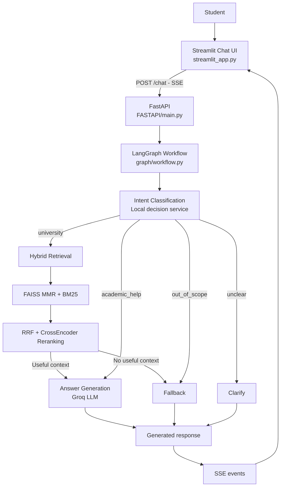

# Uni-Bot — AI-Powered University Knowledge Assistant

     

Uni-Bot is a locally run university information and academic learning assistant. It combines retrieval-augmented generation (RAG), intent-based routing, hybrid document retrieval, and a chat interface to help students find university information and understand academic or technical topics.

The main application path uses a **Streamlit frontend**, a **FastAPI streaming API**, and a **LangGraph workflow**. University-specific answers are generated using retrieved university documents. Academic-help questions are routed to the answer generator without university-document retrieval.

> **Project scope:** The current implementation is a locally run, workflow-orchestrated RAG assistant. It is not a fully autonomous multi-agent system and does not currently include cloud deployment or persistent database-backed conversation storage.

## Quick Navigation

- [Features](#features)
- [How Uni-Bot Works](#how-uni-bot-works)
- [Application Architecture](#application-architecture)
  - [LangGraph Workflow](#langgraph-workflow)
  - [Intent Classification and Answer Generation](#intent-classification-and-answer-generation)
- [Retrieval Pipeline](#retrieval-pipeline)
  - [Retrieval Settings](#retrieval-settings)
  - [Document Ingestion and Vector Store](#document-ingestion-and-vector-store)
- [Technology Stack](#technology-stack)
- [Repository Structure](#repository-structure)
- [Prerequisites](#prerequisites)
- [Installation and Configuration](#installation-and-configuration)
- [Running the Main Application](#running-the-main-application-locally)
- [Chat API](#chat-api)
- [Optional Standalone RAG Interface](#optional-standalone-streamlit-rag-interface)
- [Evaluation and Testing](#evaluation-and-testing)
- [Limitations](#conversation-memory-and-current-limitations)
- [Security](#security-and-repository-hygiene)
- [Project Status](#project-status)
- [Author](#author)

---


## Features

- **University information assistance:** Answers questions about university information using indexed PDF and DOCX documents.
- **Academic and technical assistance:** Handles academic concepts and technical questions such as programming, algorithms, and computer science.
- **Four-way intent routing:** Classifies queries as `university`, `academic_help`, `out_of_scope`, or `unclear`.
- **Hybrid retrieval:** Combines FAISS-based MMR retrieval and BM25 keyword search.
- **Rank fusion and reranking:** Uses Reciprocal Rank Fusion (RRF), followed by a Sentence Transformers CrossEncoder reranker.
- **Conversation-aware queries:** Uses recent conversation messages to help resolve follow-up questions.
- **Streaming responses:** Sends generated response chunks from FastAPI to Streamlit using Server-Sent Events (SSE).
- **Document ingestion:** Extracts PDF/DOCX content, including PDF text, table rows, and OCR text.
- **Local evaluation assets:** Includes routing, workflow, retrieval, generator, and security evaluation code and datasets.
- **Optional standalone RAG interface:** `app.py` provides a separate Streamlit interface that directly loads the vector store and RAG chain.

## How Uni-Bot Works

A student's question follows a different path depending on what they are asking.

### 1. The student asks a question

The student enters a question in the Streamlit chat interface. The frontend sends it to the FastAPI `/chat` endpoint.

### 2. The workflow identifies the question type

LangGraph calls the configured local intent-decision service. The service classifies the question into one of four categories:

| Question type | What Uni-Bot does |
|---|---|
| `university` | Searches the university knowledge base, then generates an answer if useful information is found. |
| `academic_help` | Sends the question directly for academic or technical answer generation. University-document retrieval is skipped. |
| `out_of_scope` | Returns a fallback response because the request is outside the assistant's supported scope. |
| `unclear` | Asks the student to provide more detail. |

### 3. University questions are searched

For a university question, Uni-Bot searches the indexed PDF and DOCX content. It uses two search methods together:

- **Semantic search** finds passages with a similar meaning, even when they do not use exactly the same words as the question.
- **Keyword search** finds passages that contain relevant words or terms from the question.

The results are combined and reranked so the most relevant passages can be sent to the answer-generation model. If useful university context is not found, the workflow uses its fallback response instead of following the normal university-answer path.

### 4. The answer is generated and streamed

The answer-generation model prepares the response. FastAPI sends the response to Streamlit in small text chunks, so the student can see it appear as it is generated rather than waiting for the entire response.


## Application Architecture



### LangGraph workflow

The graph is defined in `graph/workflow.py` and contains five nodes:

| Node | Responsibility |
|---|---|
| `classify_intent` | Classifies the incoming request into one of the four supported intents. |
| `retrieve_docs` | Retrieves university-document chunks for university-specific questions. |
| `generate_answer` | Generates the answer and streams text chunks through the LangGraph custom stream writer. |
| `fallback` | Handles out-of-scope questions and university questions for which useful document context was not retrieved. |
| `clarify` | Asks the student to add detail when the request is unclear. |

Routing behavior:

- `university` → retrieve documents → generate an answer if useful context is found; otherwise use the fallback response.
- `academic_help` → generate an academic/technical answer directly, without the university-document retrieval branch.
- `out_of_scope` → return the scope fallback response.
- `unclear` → ask the student to clarify the question.

There is no separate greeting node in the current graph.

### Intent classification and answer generation

Uni-Bot uses two separate model services for these tasks:

| Task | Service | Configuration |
|---|---|---|
| Question classification | Ollaya-compatible local decision service | Sends requests to `/api/decide`. Defaults: `OLLAYA_BASE_URL=http://127.0.0.1:11435` and `OLLAYA_MODEL=decider:2b`. |
| Answer generation | Groq through LangChain's `ChatGroq` | Configured in `src/llm.py` with `openai/gpt-oss-120b`. |

The answer-generation prompt handles the two main question types differently. Answers to university questions are expected to be supported by the retrieved university context. Academic-help questions are handled as academic or technical explanations.

## Retrieval Pipeline

The retrieval pipeline is implemented in `src/retriever.py`. Its job is to find the most useful parts of the university documents for a student's question.

It uses the following sequence:

1. **Create embeddings:** `sentence-transformers/all-MiniLM-L6-v2` converts text into numerical representations that can be compared by meaning.
2. **Run semantic search:** FAISS uses Maximal Marginal Relevance (MMR) to find relevant and varied candidates. It can fetch up to 60 candidates and return up to 30 for the next stage.
3. **Run keyword search:** BM25 searches for documents using the words and terms in the question. It retrieves up to 30 candidates.
4. **Combine the results:** Reciprocal Rank Fusion (RRF) combines the rankings produced by semantic and keyword search.
5. **Rerank the candidates:** `cross-encoder/ms-marco-MiniLM-L-6-v2` scores the question-document pairs and helps place the most relevant passages higher.
6. **Return the final context:** The configured `TOP_K` value is 5, so up to five final results are selected for the answer-generation step.

### Retrieval settings

The current values in `src/config.py` are:

| Setting | Value | Meaning |
|---|---:|---|
| Embedding model | `sentence-transformers/all-MiniLM-L6-v2` | Converts text into vectors for semantic search. |
| Chunk size | 1,024 characters | The target size used when splitting document text into smaller sections. |
| Chunk overlap | 200 characters | Adjacent chunks share some text to help retain context across section boundaries. |
| Final retrieval count (`TOP_K`) | 5 | Number of final retrieved results selected for the answer. |

### Document ingestion and vector store

Before Uni-Bot can search university documents, the documents must be processed and indexed. This process is called **document ingestion**. The pipeline is implemented in `src/loader.py`, `src/ingest.py`, and `src/vector_store.py`.

| Document content | How it is processed |
|---|---|
| PDF text | `PyPDFLoader` extracts text from PDF pages. |
| PDF OCR text | `pdfplumber` renders pages and `pytesseract` extracts text from images. The loader adds OCR lines that are missing from the text extracted normally. |
| PDF tables | `pdfplumber` extracts tables and converts eligible rows into structured documents containing source, page, table, and row metadata. |
| DOCX text | `Docx2txtLoader` extracts text from Word documents. |
| Extracted text | Text is normalized. Non-table documents are split using `RecursiveCharacterTextSplitter`; extracted table rows remain as row-level documents. |
| Vector-store files | FAISS data is saved under `vectorstore/` as `index.faiss`, `index.pkl`, and `chunks.pkl`. |

The vector-store builder first creates and validates a temporary staging index. It replaces the previous index only after the new one has passed validation. This helps protect a working local index from being replaced by an incomplete build.

## Technology Stack


| Area | Technology | Purpose in Uni-Bot |
|---|---|---|
| Frontend | Streamlit | Provides the student chat interface. |
| Backend API | FastAPI, Uvicorn | Receives chat requests and streams responses. |
| Workflow orchestration | LangGraph | Controls the question-processing steps and routing. |
| LLM framework | LangChain | Connects the application to the answer-generation model and RAG components. |
| Intent classification | Ollaya-compatible local decision service | Classifies each incoming question. |
| Main answer generation | Groq (`openai/gpt-oss-120b`) | Generates answers for the main LangGraph workflow. |
| Embeddings | Sentence Transformers / Hugging Face | Converts document text and queries into vectors. |
| Vector store | FAISS (`faiss-cpu`) | Stores and searches document vectors. |
| Keyword retrieval | BM25 (`rank-bm25`) | Finds passages based on query terms. |
| Reranking | Sentence Transformers CrossEncoder | Re-scores retrieved passages for relevance. |
| PDF processing | PyPDF, pdfplumber | Extracts PDF text and tables. |
| OCR | Tesseract OCR, pytesseract | Extracts text from PDF page images. |
| DOCX processing | Docx2txt | Extracts text from Word documents. |
| Evaluation | pytest, DeepEval utilities, local Qwen judge | Supports tests and evaluation of the application. |


## Repository Structure

```text
uni-chatbot/
├── FASTAPI/
│   └── main.py                 # FastAPI endpoints and SSE streaming
├── graph/
│   ├── nodes.py                # Classifier, retrieval, generation, fallback, clarify
│   ├── routing.py              # Conditional LangGraph routing
│   ├── state.py                # Graph state schema
│   └── workflow.py             # Graph construction and in-memory checkpointing
├── src/
│   ├── config.py               # Project paths and retrieval configuration
│   ├── embeddings.py           # Embedding model setup
│   ├── ingest.py               # Recommended document ingestion command
│   ├── llm.py                  # Groq and local LLM configuration
│   ├── loader.py               # PDF/DOCX loading, OCR, table extraction, chunking
│   ├── prompt.py               # Prompt used by the standalone RAG chain
│   ├── rag_chain.py            # Standalone RAG chain
│   ├── retriever.py            # Hybrid retrieval and reranking
│   └── vector_store.py         # FAISS creation, validation, loading
├── data/
│   └── documents/              # Local source PDFs and DOCX files
├── vectorstore/                # Generated FAISS index and saved chunks
├── tests/                      # Application and integration tests
├── evaluation/                 # Golden datasets and evaluation utilities
├── graph_eval/                 # Routing and workflow evaluation assets
├── security_test/                   # Prompt-injection and safety tests
├── models/                     # Local GGUF model files (not for Git)
├── app.py                      # Optional standalone RAG Streamlit interface
├── streamlit_app.py            # Streamlit frontend for the FastAPI workflow
├── rebuild_vectorstore.py      # Additional vector-store rebuild utility
├── requirements.txt
└── README.md
```

Generated files, model weights, private documents, and environment secrets should remain local and should not be committed unless there is a specific reason and permission to publish them.

## Prerequisites

The project has been developed in the following environment:

- **Operating system:** Windows
- **Python:** 3.12
- **Groq API key:** Required for answer generation in the main LangGraph application.
- **Intent-decision service:** The Ollaya-compatible service must be running and reachable at the configured `OLLAYA_BASE_URL`.
- **Tesseract OCR:** Required for OCR extraction from PDFs.
- **Internet connection:** Needed the first time Hugging Face embedding and reranker model weights are downloaded.

### Configure Tesseract OCR

The current `src/loader.py` expects the Tesseract executable at:

```text
C:\Program Files\Tesseract-OCR\tesseract.exe
```

Install Tesseract OCR on Windows. If it is installed somewhere else, update `pytesseract.pytesseract.tesseract_cmd` in `src/loader.py` to point to the correct executable.

## Installation and Configuration

Follow these steps from a PowerShell terminal.

### 1. Clone the repository

Replace `<your-repository-url>` with the URL of your GitHub repository.

```powershell
git clone <your-repository-url>
cd uni-chatbot
```

### 2. Create and activate a virtual environment

A virtual environment keeps this project's Python packages separate from other Python projects on your computer.

```powershell
py -3.12 -m venv .venv
.\.venv\Scripts\Activate.ps1
```

If PowerShell blocks activation in the current terminal, run:

```powershell
Set-ExecutionPolicy -Scope Process -ExecutionPolicy RemoteSigned
.\.venv\Scripts\Activate.ps1
```

### 3. Install the project dependencies

```powershell
python -m pip install --upgrade pip
python -m pip install -r requirements.txt
```

Some evaluation scripts also need DeepEval. The local Qwen judge needs a working `llama-cpp-python` installation. Install these optional evaluation dependencies only when you plan to run those evaluation scripts:

```powershell
python -m pip install deepeval llama-cpp-python
```

`llama-cpp-python` installation can depend on your Python version, compiler, CUDA setup, and GPU configuration.

### 4. Add environment variables

Create a file named `.env` in the project root. Add the following values:

```env
GROQ_API_KEY=your_groq_api_key
OLLAYA_BASE_URL=http://127.0.0.1:11435
OLLAYA_MODEL=decider:2b
```

Replace `your_groq_api_key` with your actual Groq API key. Do not commit `.env` to Git.

The classifier uses the Ollaya values shown above as defaults when they are not overridden. The decision service must expose the `/api/decide` endpoint.

The Streamlit frontend uses `http://127.0.0.1:8000` as the default FastAPI address. To change it, set `UNIBOT_API_URL`. FastAPI's allowed frontend origins can be configured with `UNIBOT_CORS_ORIGINS`, using a comma-separated list of origins.

### 5. Add university documents

Put the PDF and DOCX documents you want Uni-Bot to search in:

```text
data/documents/
```

Create the directory if it does not already exist. Only use documents you are permitted to process. Before making the repository public, confirm that you have permission to redistribute any university brochure or other source document.

### 6. Build the knowledge base

Run the following command from the project root:

```powershell
python -m src.ingest
```

This command processes the supported documents, extracts their content, creates chunks, and rebuilds the local FAISS index. It also prints information about the source files, extracted sections, and stored chunks.

After ingestion finishes successfully, restart FastAPI so that the running application loads the updated knowledge base.

An additional rebuild script is also available:

```powershell
python rebuild_vectorstore.py
```

`python -m src.ingest` is the recommended command because it includes input checks and status output.

## Running the Main Application Locally

The main application uses the **FastAPI + LangGraph + Groq** workflow with the **Streamlit** frontend. Before starting it, make sure the intent-classification service is running and your Groq API key is configured.

You will use two terminals from the project root. Activate the virtual environment in each terminal.

### Terminal 1 — Start FastAPI

```powershell
python -m uvicorn FASTAPI.main:app --host 127.0.0.1 --port 8000 --reload
```

FastAPI provides these endpoints:

| Method | Endpoint | Purpose |
|---|---|---|
| `GET` | `http://127.0.0.1:8000/` | Returns the API welcome message. |
| `GET` | `http://127.0.0.1:8000/health` | Checks whether the API is responding. |
| `GET` | `http://127.0.0.1:8000/docs` | Opens the interactive API documentation. |
| `POST` | `http://127.0.0.1:8000/chat` | Accepts a chat question and streams the response. |

### Terminal 2 — Start the Streamlit frontend

```powershell
streamlit run streamlit_app.py
```

Open the local URL printed by Streamlit. It is typically:

```text
http://localhost:8501
```

When a student submits a question, `streamlit_app.py` checks the FastAPI health endpoint, sends the question and conversation `thread_id` to `/chat`, reads the SSE events, and displays the streamed answer.

## Chat API

The main application exposes a streaming chat endpoint:

```text
POST /chat
```

Send a JSON request in this format:

```json
{
  "query": "What is the annual fee for BCA Core?",
  "thread_id": "optional-conversation-id"
}
```

Request fields:

- **`query`** is required. It must contain at least one non-whitespace character and can be up to 4,000 characters long.
- **`thread_id`** is optional. If you do not provide one, FastAPI generates a UUID for the new conversation.
- **For follow-up questions**, reuse the `thread_id` returned by the API so the workflow can associate the messages with the same conversation.

### Streaming response events

The API uses **Server-Sent Events (SSE)** to send the response progressively. It can return these events:

| Event | What it means |
|---|---|
| `start` | The conversation has started and the event provides its `thread_id`. |
| `token` | Contains a piece of generated answer text in the `text` field. |
| `done` | The response is complete and includes the `thread_id`. |
| `error` | The request could not be processed. |

## Optional Standalone Streamlit RAG Interface

The repository also contains `app.py`, which runs a separate, simpler RAG interface.

**This is not the main application workflow.** The standalone `app.py` interface does not call the FastAPI `/chat` endpoint and does not use the LangGraph conversation workflow. It directly loads the local FAISS vector store and RAG chain.

It provides these features:

- Loads the local FAISS vector store and cached retriever/RAG resources.
- Lets users upload PDF or DOCX files into `data/documents/`.
- Provides a button to rebuild the local knowledge base.
- Displays the answer and the first retrieved source/page when available.
- Uses `get_llm()` from `src/llm.py`, which is configured for a local GGUF model.

To run this optional interface:

```powershell
streamlit run app.py
```

The local model path and CUDA DLL directory in `src/llm.py` are machine-specific. Update `LLM_MODEL` and the CUDA DLL path in that file to match your local installation. These local GGUF settings belong to the standalone interface and are separate from the Groq-based main application.

## Evaluation and Testing

The repository includes tests and evaluation resources for different parts of Uni-Bot, including routing, workflow integration, API streaming, retrieval, answer generation, and prompt-injection or safety behavior.

A routing regression test can be run with:

```powershell
python -m pytest tests/test_routing.py -v
```

Some evaluation scripts need additional services or configuration, such as a running intent-decision service, a Groq API key, DeepEval, or a local Qwen judge. Run the test or evaluation script for the component you want to check, and make sure its required services and model configuration are available.

For the local Qwen judge, check the model path in `evaluation/judge_llm.py` before running an evaluation. This judge is used for evaluation; it is separate from the Groq model that generates answers in the main LangGraph workflow.

## Conversation Memory and Current Limitations

A few implementation details are important when running or evaluating the project:

- **Conversation memory is temporary:** LangGraph uses `MemorySaver` for in-memory checkpointing. Conversation history is associated with `thread_id`, but it is not retained after the FastAPI process restarts.
- **No application database:** Source documents and the FAISS index are stored locally as files. The current implementation does not include a persistent application database.
- **Restart after ingestion:** Rebuilding the knowledge base does not automatically refresh an already-running FastAPI process. Restart FastAPI after a successful ingestion.
- **Answers depend on source quality:** Extraction, retrieval, and answer generation all affect the result. Check important fees, dates, eligibility requirements, and other official details against the latest university source.
- **Local development scope:** The current project is configured for local development and testing. Cloud deployment, authentication, and persistent multi-user conversation storage are not part of the current implementation.
- **Different model requirements:** The main application requires the configured intent-decision service and Groq API. The optional standalone `app.py` interface has separate local GGUF model requirements.

## Security and Repository Hygiene

Keep the following points in mind when working with or publishing the repository:

- Keep `.env` files, API keys, private source documents, local model weights, and generated vector-store files out of Git unless you have a deliberate and authorized reason to publish them.
- Do not commit `.venv/`, `__pycache__/`, `.pyc` files, or local logs.
- `vectorstore/` contains locally generated data. Rebuild it from permitted source documents with `python -m src.ingest` when needed.
- The FAISS loader uses local pickle-backed files (`index.pkl` and `chunks.pkl`). Only load vector-store files created by a trusted local ingestion process. Do not load untrusted pickle files.
- Retrieved university documents are reference material, not instructions for the model to follow. The generation prompt includes context-security guidance, and the repository includes adversarial testing assets.
- Confirm that you have redistribution rights for university brochures and other source documents before making the repository public.

## Project Status

Uni-Bot is a locally tested student project that brings together four-intent routing, LangGraph workflow orchestration, hybrid RAG retrieval, Groq answer generation, FastAPI Server-Sent Events streaming, and Streamlit interfaces.

The **main supported run path** is `FASTAPI/main.py` with `streamlit_app.py`. The `app.py` file remains available as an optional standalone RAG interface.

---

## Author

**Kanishk Jain**

BCA Student | Generative AI Enthusiast | Python Developer

- GitHub: https://github.com/1kanishk
- LinkedIn: https://www.linkedin.com/in/kanishk-jain1/
